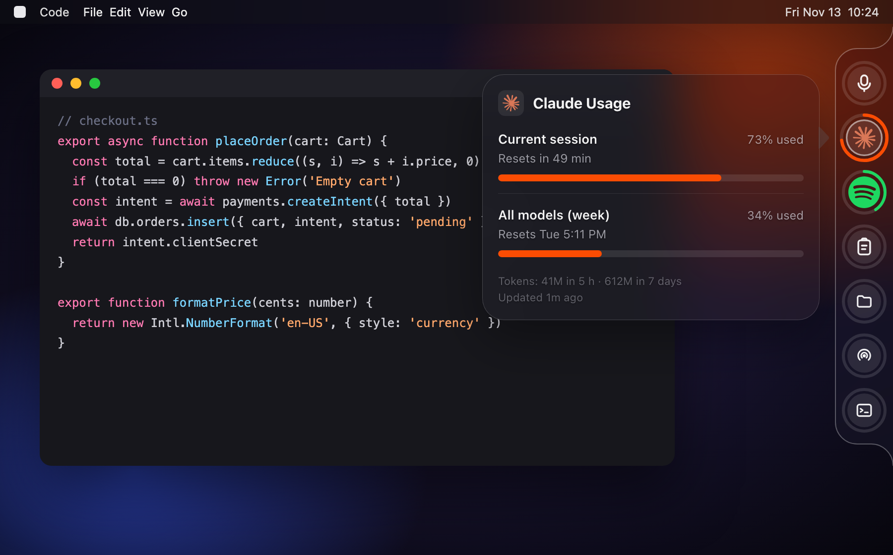
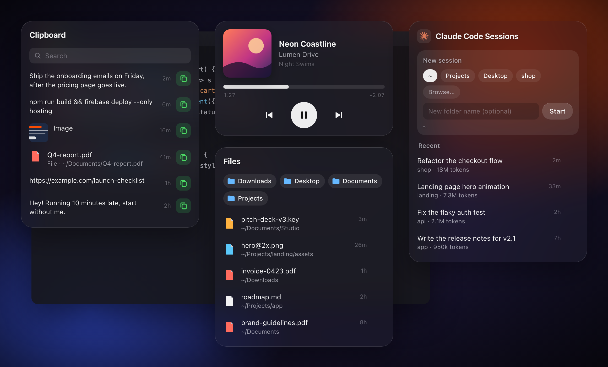
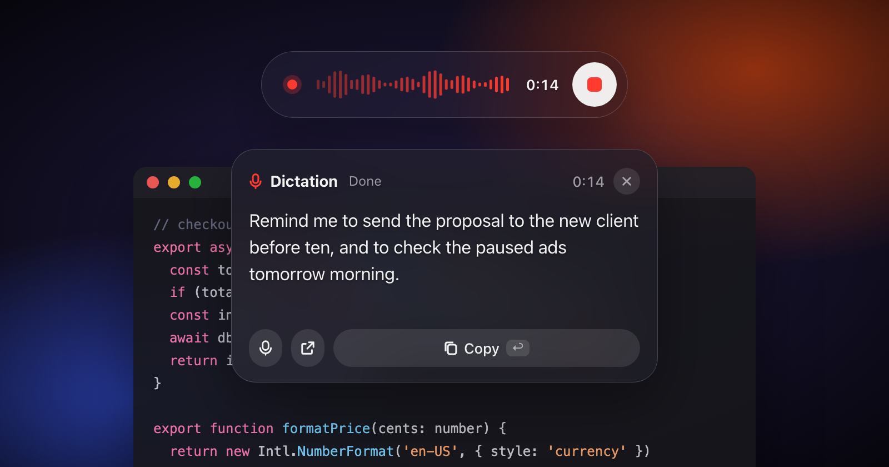

<p align="center"></p>

<h1 align="center">Ledge</h1>

<p align="center">
Una barrita de vidrio con acciones rápidas, pegada a la orilla de la pantalla de tu Mac,<br>
y dictado sin internet que escribe mientras hablas.
</p>

<p align="center">
<a href="README.md">English</a> · macOS 13+ · Apple Silicon · Python + AppKit · Todo corre en tu Mac
</p>

---

## Qué trae

Este repo tiene dos apps nativas de Mac que trabajan juntas.

| | App | Atajo | Qué hace |
|---|---|---|---|
| ▤ | **Ledge** | <kbd>⌃⌥⌘A</kbd> orilla derecha · <kbd>⌃⌥⌘Q</kbd> orilla izquierda | Una barrita pegada a la orilla de la pantalla. Pasas el mouse por un ícono y sale su tarjeta. |
| ● | **Grabadora** | <kbd>⌃⌥⌘G</kbd> | Graba y transcribe con Whisper en tu Mac. El texto aparece mientras hablas. |

### Ledge: la barrita

- **Uso de Claude**: tu sesión de 5 horas y tu límite semanal, con la hora a la que se reinicia cada uno, más los tokens que llevas. El anillo del ícono de Claude se va llenando.
- **Spotify**: qué suena, un anillo con el avance y botones de reproducir, pausar y saltar.
- **Portapapeles**: lo último que copiaste (hasta 200), con buscador. Un clic lo vuelve a copiar; si picas la fila la ves completa. Nunca guarda las contraseñas de los gestores de contraseñas.
- **Archivos**: tus archivos recientes de Spotlight y carpetas rápidas.
- **AirDrop**: suelta archivos en la tarjeta o en el ícono para mandarlos.
- **Sesiones**: tus últimas 10 sesiones de Claude Code; con un clic la reanudas en Terminal. Inicia una **sesión nueva** en cualquier carpeta, o crea la carpeta ahí mismo.
- **Dictar**: abre la tarjeta del dictado de Grabadora junto al ícono.

<p align="center"></p>

### Grabadora: el dictado

- Mientras grabas, una barrita con la onda de tu voz; el botón de parar va a la derecha.
- El texto sale en vivo mientras hablas, y al final se hace una pasada sobre toda la grabación para dejar bien la puntuación.
- <kbd>↩</kbd> copia el texto y cierra la tarjeta.
- Cada nota se guarda en una ventana de historial donde puedes buscar, renombrar, volver a escuchar o retranscribir en otro idioma.
- Whisper large-v3-turbo con [MLX](https://github.com/ml-explore/mlx): sin internet y sin llave de API. En una Mac con chip M tarda como 1 segundo por cada 10 segundos de audio.

<p align="center"></p>

## Instalar

Necesitas macOS 13 o más nuevo en Apple Silicon, y Python 3.10+. Se recomienda [uv](https://docs.astral.sh/uv/), pero no es obligatorio.

```bash
git clone https://github.com/brunovareliuu/ledge.git
cd ledge
./atajos/install.sh      # arma /Applications/Atajos.app
./grabadora/install.sh   # arma /Applications/Grabadora.app
open -a Atajos; open -a Grabadora --args --fondo
```

Cada script crea su `.venv`, arma la `.app` con su ícono y agrega un LaunchAgent para que se abra al iniciar sesión. Así los atajos siempre funcionan. (La app de Ledge se sigue armando como `Atajos.app`, que es el nombre que ve macOS.)

La primera vez:

- Grabadora baja el modelo de Whisper (~1.6 GB) de Hugging Face. Después funciona sin internet.
- macOS te pide permiso de **micrófono** (Grabadora) y de **automatización** de Spotify y Terminal (Atajos). Dale permitir.

### Uso de Claude, por la vía soportada

Claude Code le pasa los límites de tu plan (`rate_limits.five_hour` y `seven_day`) a su barra de estado. Ledge los lee de ahí, sin tokens y sin tocar el llavero. Agrega esto a `~/.claude/settings.json`:

```json
{
  "statusLine": {
    "type": "command",
    "command": "/ruta/a/ledge/atajos/statusline.sh",
    "padding": 0
  }
}
```

La barra de estado de Claude Code va a mostrar `5 h 23 % · semana 41 %`, y la barrita lo toma después de la siguiente respuesta de Claude.

## Atajos de teclado

| Teclas | |
|---|---|
| <kbd>⌃⌥⌘A</kbd> | Mostrar o esconder la barrita en la orilla derecha |
| <kbd>⌃⌥⌘Q</kbd> | Lo mismo, en la orilla izquierda |
| <kbd>⌃⌥⌘G</kbd> | Empezar o terminar el dictado desde cualquier app |
| <kbd>↩</kbd> | Copiar el texto y cerrar |
| <kbd>Esc</kbd> | Cerrar la tarjeta abierta |

Al pasar el mouse sale la tarjeta. Si le das clic al ícono se queda fija, y no se cierra mientras la usas.

## Hazlo tuyo

- **Carpetas rápidas**: pon tus carpetas extra, relativas a tu carpeta personal, en `~/Library/Application Support/Atajos/carpetas.json`. Por ejemplo `["Proyectos", "Trabajo/clientes"]`. Salen en Archivos y en sesión nueva.
- **Datos**: el historial del portapapeles vive en `~/Library/Application Support/Atajos/`; las grabaciones y sus textos, en `~/Documents/Grabadora/`.
- **Registros**: `~/Library/Logs/Atajos.log` y `~/Library/Logs/Grabadora.log`.
- Si cambias el código no hace falta reinstalar. Cierra la app y ábrela otra vez: la `.app` corre los archivos de esta carpeta.

## Cómo está hecho

- **Ventanas nativas con páginas web adentro.** PyObjC maneja AppKit: paneles sin bordes que no se roban el teclado, pegados a la orilla. Cada uno lleva un `WKWebView` transparente con HTML y CSS, así la interfaz es fácil de cambiar.
- **Vidrio de verdad.** `NSGlassEffectView` (Liquid Glass en macOS 26) y `NSVisualEffectView` con una máscara de forma para la barrita. Es una sola pieza que se curva hacia la orilla de la pantalla.
- **Atajos globales con Carbon** (`RegisterEventHotKey`). No piden permiso de Accesibilidad.
- **Las dos apps se hablan con notificaciones distribuidas de macOS.** La barrita le dice a Grabadora dónde está el ícono de Dictar, y Grabadora le contesta si está grabando.
- **Transcripción en vivo.** Mientras grabas, Grabadora retranscribe el audio pendiente cada ~0.4 s y deja fijo el texto en las pausas. Al terminar, hace una pasada final sobre toda la grabación.

## Privacidad

Todo corre en tu Mac. No se manda nada a ningún lado, salvo la descarga única del modelo de Whisper. El historial del portapapeles se salta lo que viene marcado como oculto o temporal, que es como los gestores de contraseñas marcan lo secreto.

## Desinstalar

```bash
launchctl remove com.vareliuu.atajos; launchctl remove com.vareliuu.grabadora
rm -rf /Applications/Atajos.app /Applications/Grabadora.app
rm ~/Library/LaunchAgents/com.vareliuu.{atajos,grabadora}.plist
```

## Licencia

MIT © [Bruno Varela](https://vareliuu.com).
