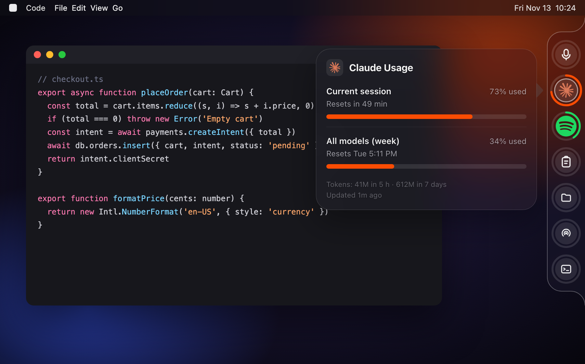
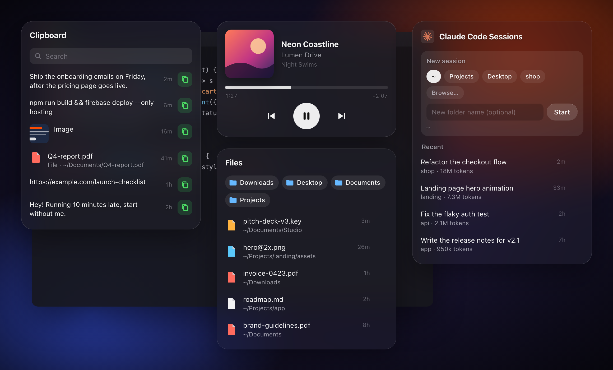
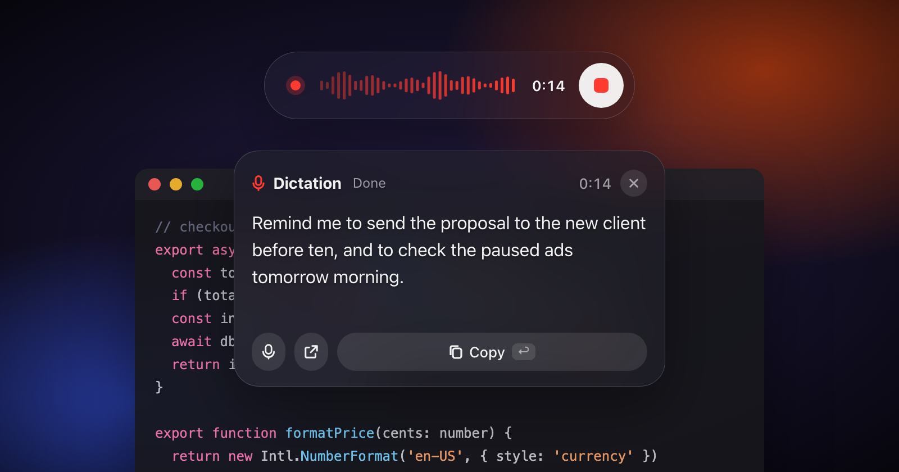

<p align="center"></p>

<h1 align="center">Atajos</h1>

<p align="center">
A glass quick-actions bar that lives on the edge of your Mac screen,<br>
plus offline dictation that types while you talk.
</p>

<p align="center">
<a href="README.es.md">Español</a> · macOS 13+ · Apple Silicon · Python + AppKit · Runs 100% on your Mac
</p>

---

## What's inside

This repo has two small native Mac apps that work together.

| | App | Shortcut | What it does |
|---|---|---|---|
| ▤ | **Atajos** | <kbd>⌃⌥⌘A</kbd> right edge · <kbd>⌃⌥⌘Q</kbd> left edge | A bar glued to the edge of the screen. Hover an icon and its card slides out. |
| ● | **Grabadora** | <kbd>⌃⌥⌘G</kbd> | Records and transcribes with Whisper on your Mac. The text appears while you talk. |

### Atajos: the bar

- **Claude Usage**: your current 5-hour session and weekly limit, with the time each one resets, plus the tokens you've used. The ring around the Claude icon fills up as you go.
- **Spotify**: what's playing, a progress ring and play, pause and skip controls.
- **Clipboard**: the last 200 things you copied, with search. One click copies it again; click a row to see it in full. Passwords from password managers are never saved.
- **Files**: your recent files from Spotlight and quick folders.
- **AirDrop**: drop files on the card or on the icon to send them.
- **Sessions**: your last 10 Claude Code sessions, one click to resume them in Terminal. Start a **new session** in any folder, or create the folder right there.
- **Dictate**: opens Grabadora's dictation card right next to the icon.

<p align="center"></p>

### Grabadora: dictation

- A small bar with your voice's waveform while you record; the stop button sits on the right.
- Live text while you talk, then a final pass over the whole recording for clean punctuation.
- <kbd>↩</kbd> copies the text and closes the card.
- Every note is kept in a history window you can search, rename, play back or re-transcribe in another language.
- Whisper large-v3-turbo through [MLX](https://github.com/ml-explore/mlx): no internet and no API key. It's quick, about 1 second for 10 seconds of audio on an M-series Mac.

<p align="center"></p>

## Install

You need macOS 13 or later on Apple Silicon, and Python 3.10+. [uv](https://docs.astral.sh/uv/) is recommended but optional.

```bash
git clone https://github.com/brunovareliuu/atajos.git
cd atajos
./atajos/instalar.sh      # builds /Applications/Atajos.app
./grabadora/instalar.sh   # builds /Applications/Grabadora.app
open -a Atajos; open -a Grabadora --args --fondo
```

Each script creates its own `.venv`, builds the `.app` with its icon and adds a LaunchAgent so it opens when you log in. That way the shortcuts always work.

The first time:

- Grabadora downloads the Whisper model (~1.6 GB) from Hugging Face. After that it works offline.
- macOS asks for the **microphone** (Grabadora) and for **automation** of Spotify and Terminal (Atajos). Allow them.

### Claude usage, the supported way

Claude Code passes your plan limits (`rate_limits.five_hour` and `seven_day`) to its status line. Atajos reads them from there, with no tokens and no Keychain. Add this to `~/.claude/settings.json`:

```json
{
  "statusLine": {
    "type": "command",
    "command": "/path/to/atajos/atajos/statusline.sh",
    "padding": 0
  }
}
```

Your Claude Code status line will show `5 h 23 % · semana 41 %`, and the bar picks it up after Claude's next reply.

## Shortcuts

| Keys | |
|---|---|
| <kbd>⌃⌥⌘A</kbd> | Show or hide the bar on the right edge |
| <kbd>⌃⌥⌘Q</kbd> | Same, on the left edge |
| <kbd>⌃⌥⌘G</kbd> | Start or stop dictation from any app |
| <kbd>↩</kbd> | Copy the transcript and close |
| <kbd>Esc</kbd> | Close the open card |

Hover shows a card. Click an icon to pin it, and it stays open while you use it.

## Make it yours

- **Quick folders**: list extra folders, relative to your home, in `~/Library/Application Support/Atajos/carpetas.json`. For example `["Projects", "Work/clients"]`. They show up in Files and in New session.
- **Data**: the clipboard history lives in `~/Library/Application Support/Atajos/`; recordings and transcripts in `~/Documents/Grabadora/`.
- **Logs**: `~/Library/Logs/Atajos.log` and `~/Library/Logs/Grabadora.log`.
- After editing the code you don't have to reinstall. Quit the app and open it again: the `.app` runs the files from this folder.

## How it's built

- **Native windows, web views inside.** PyObjC drives AppKit: borderless, non-activating panels at the screen edge, so they never steal your keyboard. Each panel hosts a transparent `WKWebView` with plain HTML and CSS, so the UI is easy to change.
- **Real glass.** `NSGlassEffectView` (Liquid Glass on macOS 26) and `NSVisualEffectView` with a shape mask for the bar. The mask is one piece that curves into the screen edge.
- **Global shortcuts with Carbon** `RegisterEventHotKey`. They don't need Accessibility permission.
- **The two apps talk over macOS distributed notifications.** The bar tells Grabadora where the Dictate icon is, and Grabadora answers with its recording state.
- **Live transcription.** While you record, Grabadora re-transcribes the pending audio every ~0.4 s and commits text at pauses. When you stop, it runs one final pass over the whole recording.

## Privacy

Everything runs on your Mac. Nothing is sent anywhere, except the one-time Whisper model download. The clipboard history skips items marked as concealed or transient, which is how password managers flag secrets.

## Uninstall

```bash
launchctl remove com.vareliuu.atajos; launchctl remove com.vareliuu.grabadora
rm -rf /Applications/Atajos.app /Applications/Grabadora.app
rm ~/Library/LaunchAgents/com.vareliuu.{atajos,grabadora}.plist
```

## License

MIT © [Bruno Varela](https://vareliuu.com). The bar and the dictation card are in English; Grabadora's history window and the code comments are in Spanish.
